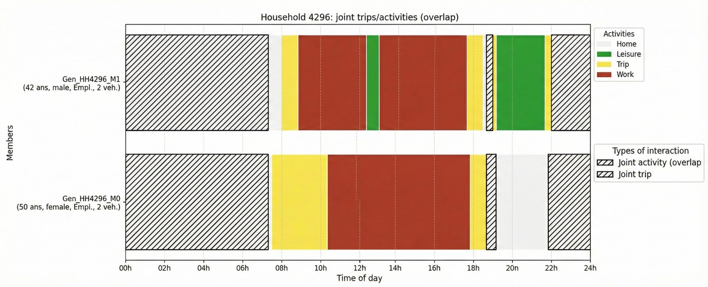

# GRETTIA Internship Portfolio: Household Interaction-Aware CVAE (CAVEAT Adaptation)

This repository is a **portfolio snapshot** of my internship work at the GRETTIA lab (Université Gustave Eiffel). It summarizes and packages what I implemented on top of the upstream **CAVEAT** project to model **household-level interactions** in activity schedules.

This is **not** the official upstream repository. Some internship-specific elements (e.g., internal data or non-shareable assets) are intentionally **not included**.

**Upstream base:** https://github.com/big-ucl/caveat (MIT), referenced at commit `af99a43`.

**Internship presentation:** [slides (PDF)](slides/slides_GRETTIA.pdf) — supervised by Etienne Côme and Latifa Oukhellou (GRETTIA, Université Gustave Eiffel), March 2026.

## Results at a glance

Synthetic populations for multi-agent transport simulation (e.g. MATSim) need realistic daily activity schedules. Current pipelines assign schedules **person by person**, which destroys coordination between household members (joint activities, shared trips, school drop-offs). The internship addressed this with two complementary approaches, evaluated against the Île-de-France household travel survey (EGT 2010: 14,736 households, 34,580 individuals).

**1. Hierarchical household matching** assigns schedules to whole households, using progressive constraint relaxation over household- and individual-level attributes. It serves as an upper bound that strictly preserves observed joint behaviours.

| Joint behaviour | Survey (EGT) | EQASIM (individual matching) | Household matching (ours) |
|---|---|---|---|
| Share of joint activities | 10.7% | 0.18% | **10.6%** |
| Share of joint trips | 11.2% | 0.46% | **11.3%** |
| Share of escort trips | 4.3% | 0.89% | **3.9%** |
| Joint-activity start time, EMD (min) | – | 84.90 | **9.94 ± 1.25** |
| Joint-trip start time, EMD (min) | – | 153.85 | **15.73 ± 1.39** |

Household matching reproduces about 98% of the survey's joint-activity rate, against under 2% for individual-level matching, at the cost of slightly worse individual-level metrics (all members must come from the same donor household).

**2. Household CVAE** generates new schedules rather than copying survey households. Five household architectures were built incrementally and compared with a discrete CNN reference model (lower is better; best in bold):

| Metric | DiscCNN | VAE | CVAE | Att | FullAtt | FullHier |
|---|---|---|---|---|---|---|
| Activity count EMD | 0.279 | 0.309 | 0.292 | **0.267** | 0.306 | 0.341 |
| Duration EMD (min) | 40.23 | 53.61 | 51.79 | 26.68 | **25.02** | 44.97 |
| Start time EMD (min) | **26.48** | 39.79 | 37.81 | 27.54 | 32.14 | 47.83 |
| 2-gram L1 | 0.325 | 0.304 | **0.286** | 0.386 | 0.432 | 0.514 |
| 3-gram L1 | 0.634 | 0.641 | **0.574** | 0.636 | 0.766 | 0.835 |
| Joint-activity duration EMD (min) | – | – | – | **22.14** | 44.74 | 93.80 |
| Joint-activity start time EMD (min) | – | – | – | **20.04** | 40.45 | 75.24 |
| Joint-trip start time EMD (min) | – | – | – | **61.76** | 80.16 | 230.51 |

*DiscCNN: discrete CNN reference model from CAVEAT · VAE: household VAE · CVAE: + FiLM conditioning on demographic/household attributes · Att: + time-wise social attention and interaction supervision · FullAtt: + full-day pairwise attention · FullHier: + hierarchical latents (z_coord + z_indiv).*

Adding social attention and interaction supervision halves the duration error compared with the plain CVAE and gives the best joint-behaviour metrics. The generative models show near-zero training-set memorization (closest train/test bias 0.00–0.03, vs 0.88 for matching), i.e. they produce new schedules instead of reproducing survey households.



## Project goal

The internship objective was to extend CAVEAT so that a VAE/CVAE can model not only individual activity schedules, but also **explicit household interactions** (e.g., joint activities / joint trips) between members.

In practice, I focused on:
- discrete schedule encoding,
- CNN-based encoder/decoder variants,
- household-level modelling,
- interaction-aware conditioning and supervision,
- a hierarchical CVAE design for coordination between household members.

## Internship additions: architectures

I implemented and compared several household-oriented variants, culminating in a **hierarchical household CVAE** with interaction supervision and cross-member masked attention.

Key ideas:
- **Household discrete VAE/CVAE variants** using CNN blocks for household tensors *(members × time × activities)*.
- **Interaction-aware CVAE** with a dual output branch:
  - schedule logits (activity generation),
  - interaction logits (explicit supervision signal for interaction events).
- **Cross-member masked attention** to let each member attend to other household members while:
  - masking padded/absent members,
  - excluding self-pairs,
  - using gated/residual updates for stability.
- **Hierarchical CVAE mode** (`use_hierarchical`) with coordination and individual latents to separate:
  - household-level coordination,
  - member-level behaviour.
- **Social loss handling** with configurable weighting and imbalance options (`social_loss_weight`, `social_inter_pos_weight`, etc.).

Model variants added/adapted:
- `household_discCNN_VAE`
- `household_discCNN_VAE_enhanced`
- `household_discCNN_CVAE`
- `household_discCNN_CVAE_attention`
- `household_discCNN_CVAE_att_interactions`
- `household_discCNN_CVAE_fullattention_interactions`

## Evaluations added

### Interaction overlap evaluation

I added an evaluator (`caveat/evaluate/interaction_overlap_evaluator.py`) that measures interaction quality **directly from predicted vs supervised interaction signals**, rather than only inferring joint behaviour from schedules.

Supported inputs:
- `test_inference` outputs (`interaction_probs.csv`, `interaction_targets.csv`, `interaction_mask.csv`)
- interval CSV files for reference/model interactions

### Metrics / outputs

- joint trip / joint activity counts
- distribution comparisons for interaction-related behaviour (with EMD summaries), including:
  - joint activity duration
  - joint activity start time
  - joint trip start time
- latent analysis (posterior/prior diagnostics):
  - µ density plots
  - correlation analysis
  - shape diagnostics
  - UMAP projections

Many evaluation metrics follow the methodology in:
Shone, F. & Hillel, T. (2025). *Synthesising activity participations and scheduling with deep generative machine learning*. Transportation Research Part C, 179, 105273. DOI: 10.1016/j.trc.2025.105273


## Why this matters

This work moves from individual schedule generation toward **household-level generative modelling with explicit interaction structure**, which is more realistic for many mobility/activity applications.

## Citation

If you cite the original framework/research, please use the upstream CAVEAT citation metadata (`CITATION.cff`) from:
- https://github.com/big-ucl/caveat


## Installation (for this portfolio snapshot)

Follow the **installation steps from the upstream CAVEAT repository** first (environment creation + editable install), because this work is built on top of that codebase and tooling.

Then, in this repo clone, run the household discrete training entrypoint:

```bash
python -m caveat.train_hh_disc --config configs/household_discCNN_VAE.yaml
```

For my internship models, use one of the household interaction-aware configs, for example:

```bash
python -m caveat.train_hh_disc --config configs/household_discCNN_CVAE_attention_interactions.yaml
python -m caveat.train_hh_disc --config configs/household_discCNN_CVAE_attention_interactions_hierarchical.yaml
python -m caveat.train_hh_disc --config configs/household_discCNN_CVAE_fullattention_interactions_hierarchical.yaml
```

Notes:
- `caveat/train_hh_disc.py` is the main entrypoint for the household discrete models added/adapted during the internship.
- It supports training and checkpoint-based runs (`--mode train` or `--mode ckpt`) with optional inference/generation/evaluation flags.
- Use the config file to select the architecture variant (`VAE`, `CVAE`, attention, interaction-aware, hierarchical).

## Credits / upstream

Derived from:
- https://github.com/big-ucl/caveat (commit `af99a43`)
- License: MIT (see `LICENSE`)
- Citation metadata: upstream `CITATION.cff`

All mistakes are mine; credit for the original project belongs to the upstream authors.